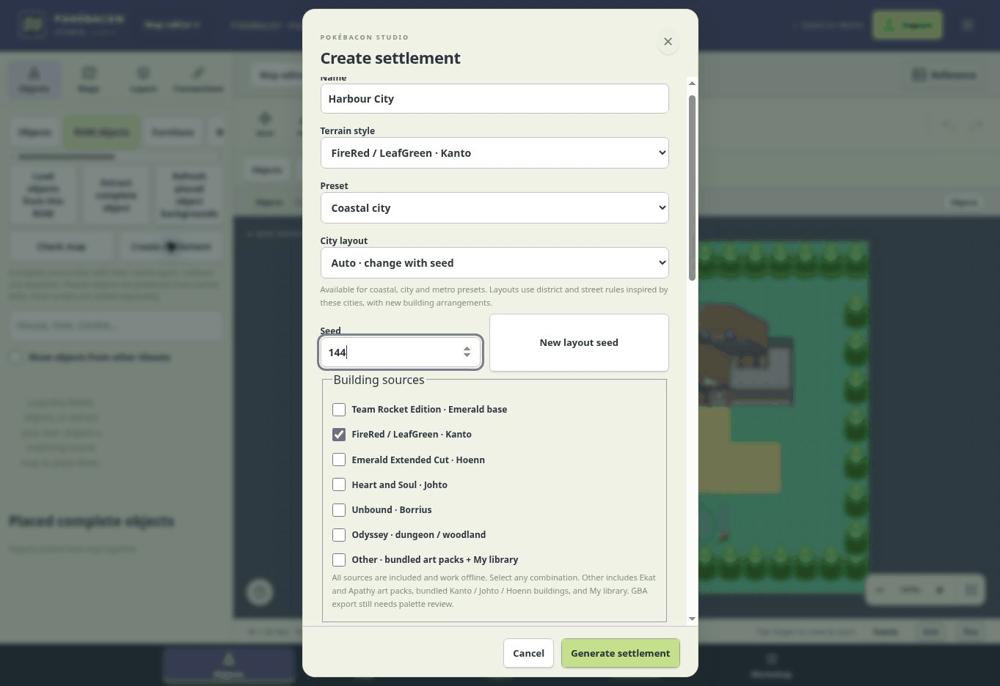
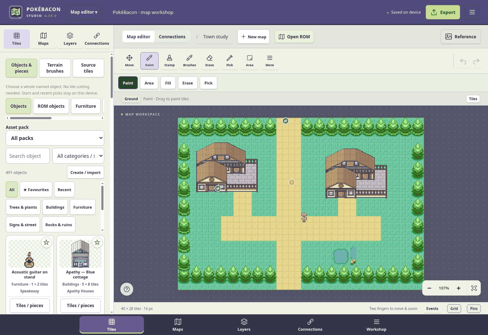
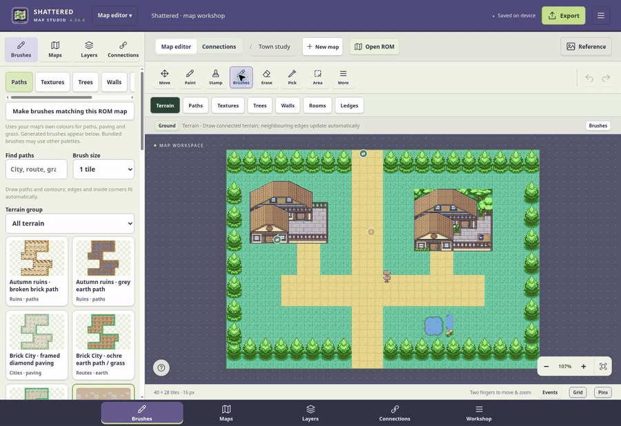
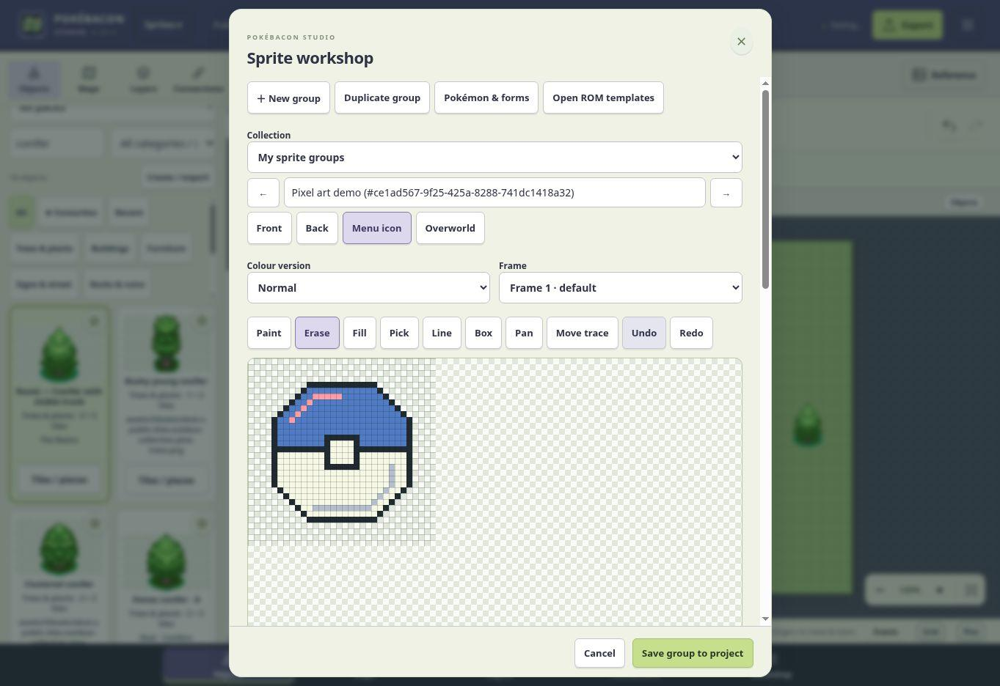
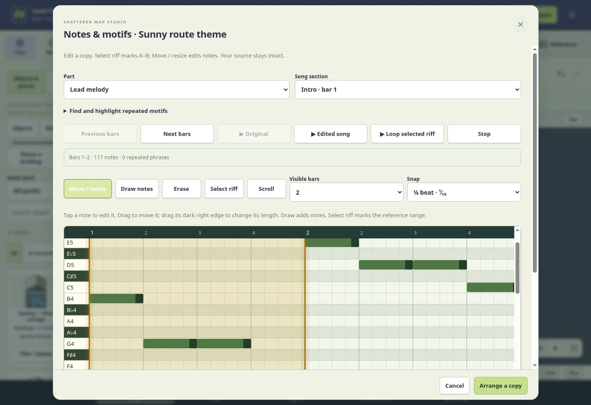
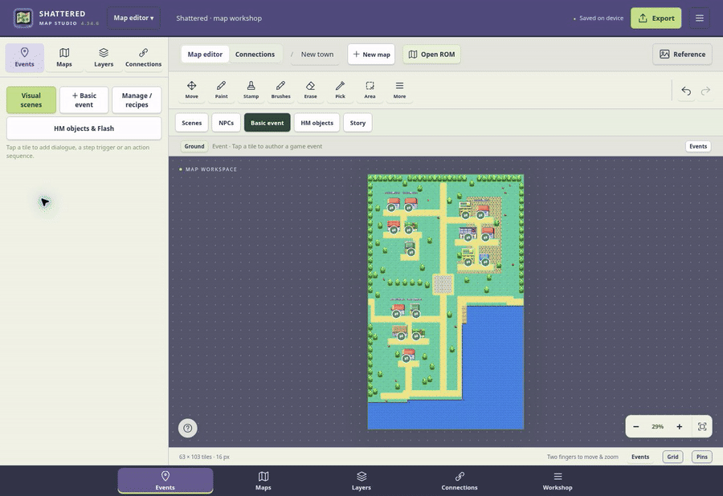
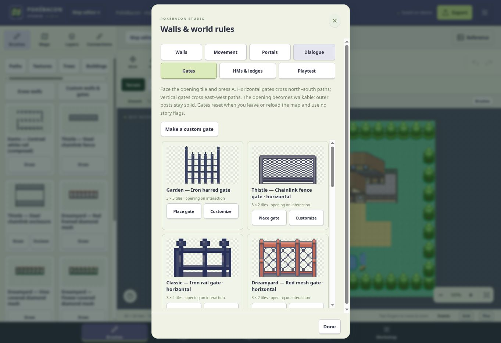
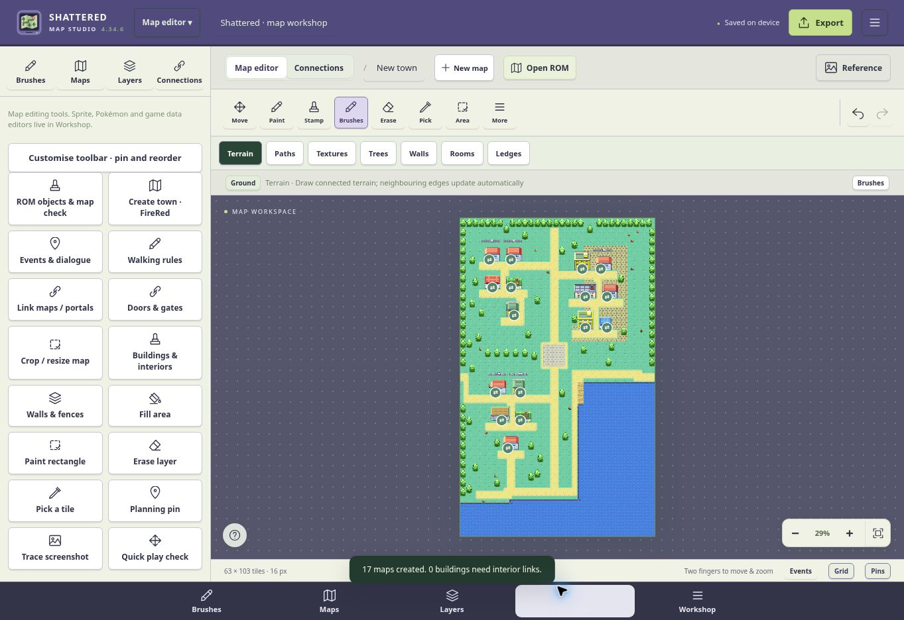

# PokéBacon Studio

**Make your Pokémon ROM hack from start to finish on your phone or Android handheld.**

I wanted to build a ROM hack without being tied to a PC or needing a dozen different programs open. PokéBacon Studio puts maps, events, quests, sprites, music and game data in one place, with touch controls made for a phone or handheld Android device.

Open a supported base ROM, build your world, add its characters and story, make the music, playtest it, and export a separate playable ROM—all on the same device. The APK works offline. You don't need a PC for that editing and supported ROM-export workflow. This builds on an existing game base; it isn't a new GBA engine or a guarantee that every ROM hack supports every native feature.

## Try it

**[Download the Android APK](https://github.com/xbaconator9000x/shattered-map-studio/releases/latest)** — grab the `.apk` under Assets, open it on your phone and allow installation from your browser when Android asks.

**[Open the web editor](https://xbaconator9000x.github.io/shattered-map-studio/)** — no install needed. Open the link in your browser, choose **Open ROM**, and select your own `.gba` file. You don't need GitHub or a development setup to use it.

The Android APK packages the editor for offline use. The browser version is available at the link above. Back up your projects before clearing app or browser data; those saves aren't a cloud account or an automatic sync between devices.

**Coming soon: iOS.** Planned, with no release date yet.

## Map maker

Paint your maps, sort out the layers and collision, link the exits, then see how they play. Ground, details, objects and overhead tiles stay separate. Imported ROM maps are editable—not just pictures to paint over.


## Map generator

Want a starting point? Pick a village, town or city, choose the biome, buildings and exits, and generate it. Don't like the layout? Change the seed and have another go. Interiors can be created and linked too. Everything stays editable afterwards.



## Stamps and asset library

Place a whole house or tree instead of hunting down every tile. Browse buildings, furniture, interiors and decorations by pack or category, save favourites, and keep your own reusable pieces.



## Brushes

Draw connected paths, mix tree varieties, paint terrain, or build walls and fences. The building brush paints rows of complete, solid background buildings for dense city blocks, with room left in front. Use the normal building tools for working doors and interiors. The brushes handle matching edges and corners; you can still edit individual tiles when you want to.



## Sprite maker

Draw and edit pixels, trace a reference, change palettes and work across front, back, menu and overworld frames. Normal and shiny palettes, animation frames and editable layers stay with the sprite group. Open a compatible ROM to use its existing artwork as a template.

The screenshot shows a new blank group and its editing controls.



## Music maker

Import MIDI or compatible ROM tracks, choose the track you actually want to work with, and edit the notes and arrangement. Select an A–B motif visually, then control how closely a composition follows it, how often it appears and which sections use it. Set the intro, main theme and bridge lengths, instruments, tempo, key and scale.



## Music generator

Pick a vibe—route, forest, cave, town, ocean, gym, battle, villain and more—then make a track and tweak it. Quick Track builds sections, not just a short loop. Keep the take you like, change the seed for another, or take it into the note editor.


### What's doing the composing?

**Hybrid is the recommended mode.** It combines a contour suggested by a GAN checkpoint from MusiGAN's Pokémon MIDI experiments with a general music model that develops that idea over the song's chords. The first stage gives the melody a direction; the second turns that into phrases. Studio supplies the arrangement and fits the result to GBA timing and voice limits. These are two models working in sequence, rather than one model retrained by combining their weights.

There are three choices:

| Mode | What it uses |
| --- | --- |
| **Hybrid composer · recommended** | MusiGAN suggests a melodic contour. Studio fits that to the arrangement, then Magenta MusicRNN develops it into chord-aware phrases. Studio handles the song structure, harmony, rhythm, cadence and GBA limits. |
| **Melody composer** | Magenta MusicRNN develops the melody over Studio's arrangement, without the MusiGAN contour stage. |
| **Phrase composer · instant** | Studio's preset and phrase rules create the score directly. This is the quickest option and doesn't run either pretrained model. |

The bundled models run locally. Magenta uses the **MusicRNN `chord_pitches_improv` checkpoint**, through **Magenta.js 1.23.1** and **TensorFlow.js 2.8.6**, with a WebAssembly backend where available. It is a general melody model. The MusiGAN stage uses the converted pretrained GAN generator identified in its [model metadata](dist/vendor/musigan/meta.json). This integration uses that GAN, not the upstream project's separate LSTM or GRU experiments.

The models help write note sequences. Instrument sounds come from the Studio cartridge palette or a compatible imported ROM bank. You can still edit the notes, motifs, instruments and song sections afterwards.

### Music credits

- **[MusiGAN](https://github.com/elsalmi/MusiGAN)** — elsalmi and the upstream contributors; source of the pretrained GAN generator used for contour suggestions. The converted model retains its source identity in the bundled metadata. Upstream does not provide a blanket licence in its repository root; credit here does not assign redistribution rights to its material.
- **[Magenta.js / MusicRNN](https://github.com/magenta/magenta-js)** and the `chord_pitches_improv` checkpoint — The Magenta Authors / Magenta Team, Apache-2.0.
- **[TensorFlow.js](https://github.com/tensorflow/tfjs)** and its WebAssembly backend — Google LLC and contributors, Apache-2.0.
- **Tonal** (MIT) and **protobuf.js** (BSD-3-Clause) — their respective authors and contributors; included in the MusicRNN browser bundle.

The applicable Magenta, model and runtime licences are included in [the bundled music notices](dist/vendor/magenta/NOTICE.txt) and [licence files](dist/vendor/magenta). Studio's arrangement, motif controls, GBA conversion and playback integration are credited to xbaconator9000x.

### Have a listen

**[Open the music demo player](https://xbaconator9000x.github.io/shattered-map-studio/examples/)** — five tracks with proper audio controls. Open this in your browser, not GitHub's file viewer.

- **Sunny route:** upbeat travelling theme.
- **Forest trail:** winding woodwind-style phrases.
- **Deep cave:** slower, darker and more spacious.
- **Trainer battle:** faster and more driven.
- **Town after dark:** softer and calmer.

Each has an MP3 and an editable MIDI download on the player page. All five 65-second previews use **Hybrid composer**, with both MusiGAN and Magenta stages completed, followed by the original Studio cartridge sound palette. Seeds, model-stage records and playback notes are listed there.

## Scripting, events and quests

Write dialogue, place triggers, move NPCs and arrange action sequences. Use conditions, flags and counters to remember what the player has done. Start with an event or linked quest template, then change the stages to suit your story.



## Doors and gates

Link doors to interiors, set arrival points, and place opening gates. Choose existing gate artwork or make your own, including horizontal and vertical layouts.



## Game data, field rules and playtesting

Edit supported Pokémon data, trainers, encounters, items and text. Change each HM's requirements, use items or quest progress instead, and configure persistent cleared obstacles. Add compatible weather and scene effects, check the project for problems, and playtest before exporting.



## What's in it?

### Maps and world building

- Paint individual tiles or stamp whole buildings, trees, furniture and other objects. Search asset packs, keep favourites, and make your own reusable pieces.
- Separate ground, detail and overhead layers, automatic collision defaults, and manual movement/footprint editing. One-way ledges, water and obstacles have their own behaviour.
- Terrain, path, tree and rocky-wall brushes; map resizing and cropping; colour picking and palette tools.
- Generate towns, villages, cities and interiors with biome presets, building choices, source families, exits and variation seeds. Generated layouts are a starting point you can edit, not a substitute for checking your map.
- Building/interior templates, Pokémon Centres, marts, gyms and multi-floor department stores.
- Connect neighbouring maps, position scrolling exits, edit doors and warps, and arrange the world visually. Edit supported Town Map artwork and location bounds too.

### Events, quests and field rules

- Place NPCs, write dialogue, draw movement paths, and build scenes with triggers, conditions, branches and repeatable or one-time events.
- Quest templates, stages and prerequisites, plus shops and interactive objects.
- Weather and compatible field effects, including screen shakes, rock falls and reflections.
- Adjust requirements separately for each HM: badges, items, possession, events or quest progress. Configure persistent cleared obstacles and conditional Strength puzzles.
- Preview maps and events in the playtester, with validation and debugging tools to help catch broken links and movement problems.

### Game data and sprites

- Edit supported Pokémon data, trainer parties, encounters, items, dialogue, menu text and game rules.
- Browse compatible ROM sprites, edit copies or use templates, work with palettes and animation frames, and manage imported artwork.
- Supported animated tiles, door animations, cries and asset-usage tools appear when the source exposes the required data.
- Source-project tools for supported decompilation workflows. Native features depend on the actual base and adapter; opening a ROM doesn't magically make every engine extension compatible.

### Music

- Import MIDI or compatible ROM music, preview individual tracks, and choose which reference to compose from.
- See and edit notes, select an A–B motif, and decide how closely the new track should follow it, where it appears and how often it returns.
- Quick Track presets for different settings and moods, with genre, key, scale, tempo and variation controls.
- Build intros, main themes and bridges with section lengths and a repeating song structure, rather than just a tiny loop.
- Hybrid composition, arrangement and instrument controls, playback with a stop button, and GBA-aware timing and voice limits.

### Import, export and backups

- Import supported ROM maps with editable layout and movement data instead of treating them as one flat picture.
- Save editable project backups, review export warnings, and compile a separate edited ROM where the source supports it. Your original ROM stays untouched.
- In-app help and shortcuts. Compatibility checks make unsupported native features explicit instead of pretending they were exported.

## Running locally

The editor is a static web application. Serve the repository root over HTTP, then open `dist/index.html` in a browser:

```sh
python3 -m http.server 8080
```

Open <http://localhost:8080/dist/> and choose **Projects → Help & shortcuts** for the in-app guide.

The included **Publish editor page** workflow deploys `dist/` to GitHub Pages on pushes to `main`. After the first successful workflow run, GitHub shows the published page under the repository's **Deployments** menu.

1. Choose **Open ROM** and select the `.gba` file you are authorised to edit. The original file remains unchanged.
2. Import maps or create a new planning map.
3. Paint the ground first, then use **Layers** for details, objects and overhead tiles. Use **Connections** to join maps and **Collision** to check movement before exporting.
4. Use **Game workshop** for scenes, dialogue, quests, shops, Pokémon data, trainer parties, encounters, sprites, and native game options.
5. Use **Export → Edited GBA ROM** to compile a separate playable copy. The review step reports unsupported features, map limits, and unresolved links before writing the file.

## Authoring notes

- Imported maps retain the ground, detail, overhead, and movement layers exposed by the source layout. If a layout cannot be decoded safely, it is shown as a planning map instead of being silently flattened.
- Objects use transparent cutouts and movement masks. The **Footprint** editor shows which cells block movement, allow walking behind, or remain walkable.
- Ledges are one-way by default. Water, HM objects, gates, doors, and portals have explicit previews and validation.
- Generated towns and interiors are bounded to the selected tile family. The generator checks edges, corners, building footprints, entrances, collision, and exits before accepting a layout.
- Projects can be backed up as editable `.pokebacon.json` files. Keep a backup before clearing browser or app data.

The **World map** tool arranges maps visually and can edit supported Town Map artwork and location bounds. The **ROM dialogue**, **Menu text**, **Game rules**, **Animated tiles**, and **Asset usage** tools appear when the opened source exposes the matching native table.

## Music

Music tools import GBA/Sappy and MIDI material, show track names and parts, and let you select a visible A–B motif. A reference composition can use an exact motif or an inspired motif, with controls for resemblance, placement, section scope, key, scale, genre, tempo, and variation seed. Quick Track presets create an intro, repeating main theme, and bridge in one pass. **Hybrid composer** is the recommended mode; it runs offline and keeps the result within GBA timing and voice limits.

## Test the source

Node.js 20 or newer is recommended. The test suite has no install step or network dependency:

```sh
npm test
```

The portable tests exercise models, import/export logic, map validation, native data handling, music composition, and editor utilities. ROM-specific emulator fixtures are intentionally not part of the public repository.

## Build the Android package

The wrapper uses the Android SDK and JDK 17 directly; Gradle and Maven are not required. Set the SDK and signing variables locally, then run:

```sh
export ANDROID_SDK_ROOT=/path/to/android-sdk
export MAP_STUDIO_KEYSTORE=/path/to/your/release-key.jks
export MAP_STUDIO_KEY_ALIAS=mapstudio
export MAP_STUDIO_KEY_PASSWORD='use-a-local-secret-store'
python3 android/build.py
```

The signed APK is written to `dist/`. Never commit a keystore, password, or generated signing files. `android/repack-assets.py` can update web assets in an existing signed shell when the native source and signing certificate are unchanged.

## Compatibility and limits

The editor supports common Generation III map, graphics, event, and music layouts and can discover compatible tables in many ROMs. Native features are enabled only after table and pointer checks pass. Unsupported native code does not disable map planning, asset organization, or project backup.

New battle mechanics, arbitrary script code, extra native capacity, and unknown save layouts require a compatible source adapter. The export review explains a limitation before writing anything and leaves the source ROM untouched.

## Credits and permissions

Developed by xbaconator9000x. Bundled art and reference libraries retain their original credit and usage terms in [`dist/assets/credits`](dist/assets/credits). Imported artwork remains the responsibility of the person who imports it. ROM-format research references PokéWebKit, [pret/pokefirered](https://github.com/pret/pokefirered), and [pret/pokeemerald](https://github.com/pret/pokeemerald). Third-party licenses and notices are preserved with the relevant files.

No blanket license is asserted for bundled game-derived or third-party artwork. Check each credit file before redistributing assets or a derivative ROM.

## Contributing

Please read [`CONTRIBUTING.md`](CONTRIBUTING.md) before opening an issue or pull request. Bug reports should include the browser or Android version, source type, reproducible steps, and a redacted project sample when one is necessary. Do not upload ROMs, save files, signing keys, passwords, or other material you are not authorised to share.
